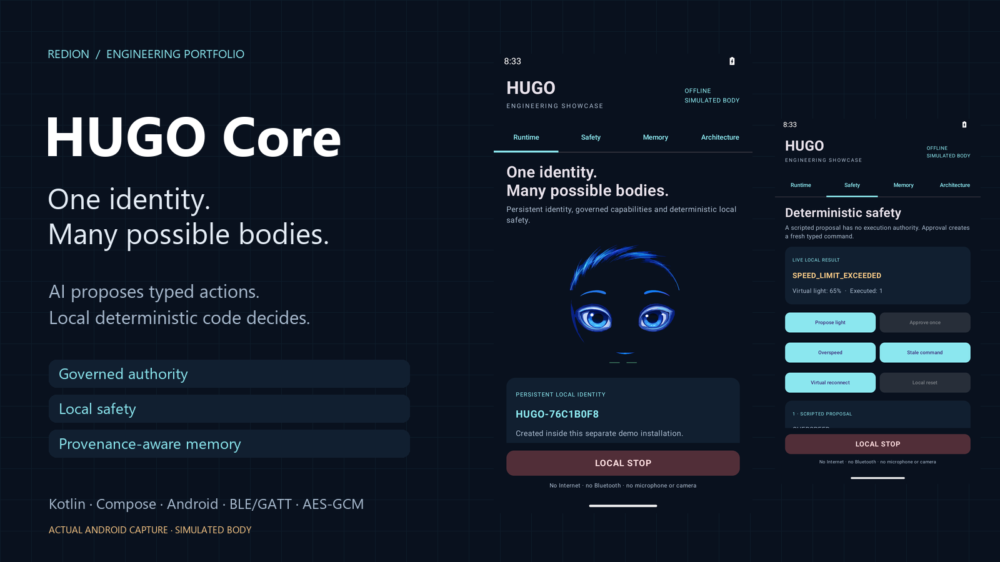
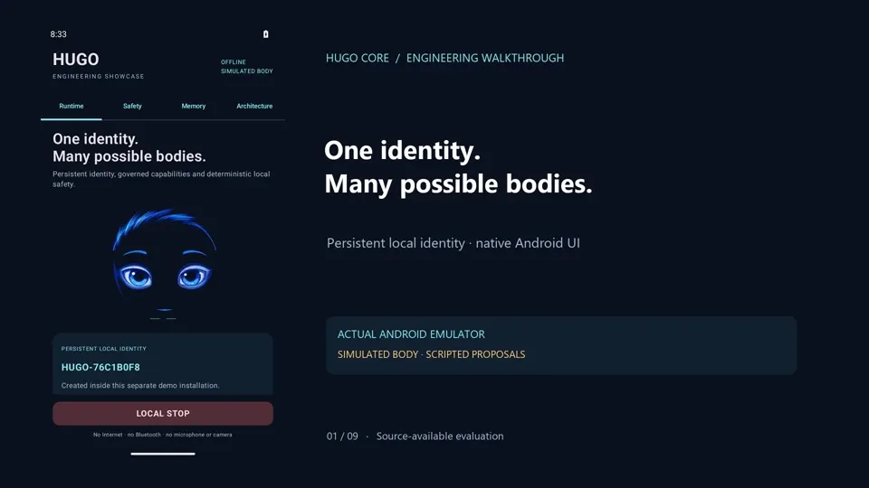
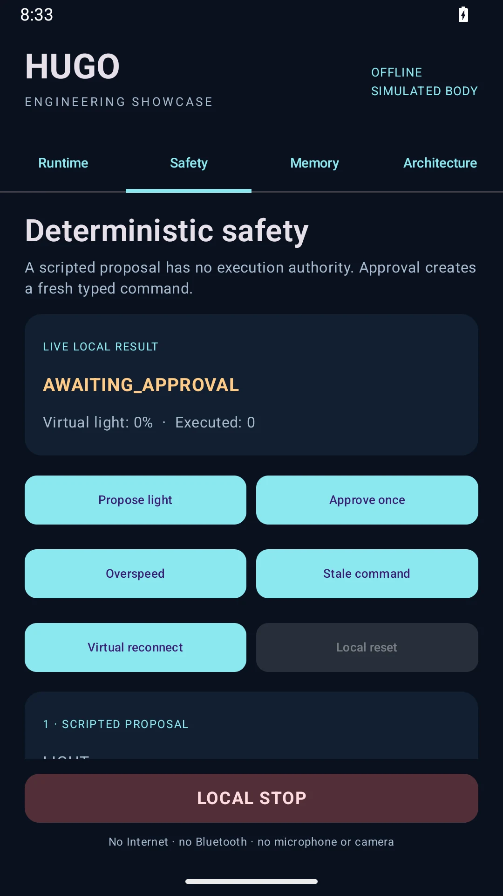
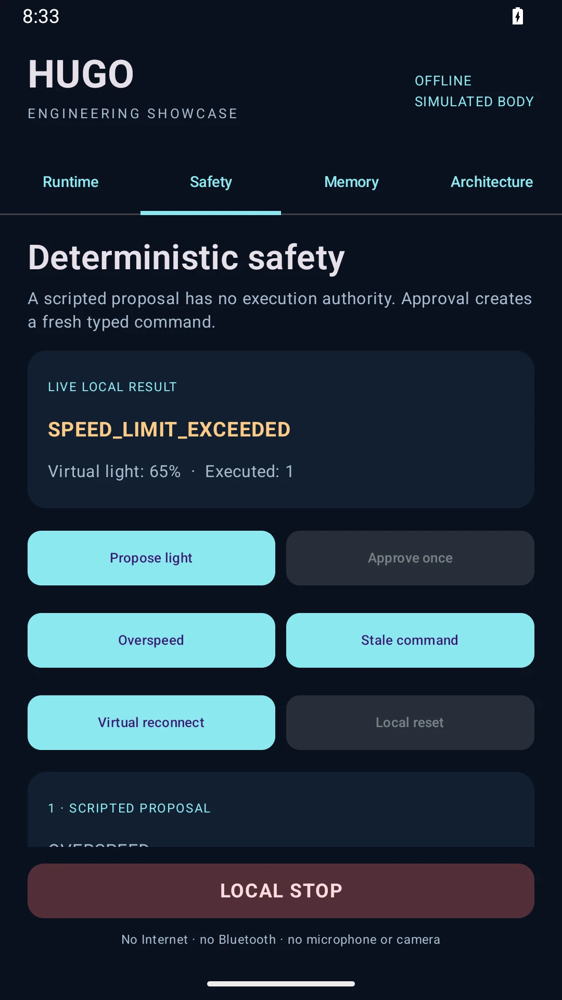
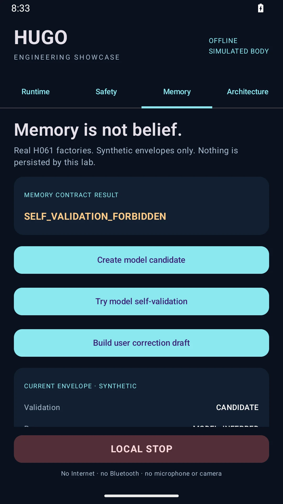

# HUGO Core

**One identity. Many possible bodies.**

A portable, local-first intelligence runtime for authorized bodies, devices and services. AI can propose typed actions. Only deterministic local code may authorize and execute them.

[](https://github.com/IamRedi/hugo-core-showcase/actions/workflows/android.yml)

**Kotlin · Jetpack Compose · Android · BLE/GATT · AES-256-GCM · Pure JVM contracts**



[Deutsch](README.md) · [Engineering](docs/ENGINEERING.md) · [Verification](EVIDENCE.md) · [Attribution & provenance](THIRD_PARTY.md)


> **Evidence and limitations:** Local-first Android runtime with governed AI action proposals and deterministic authorisation. The public showcase uses a simulated device body; JVM tests and build results do not constitute acceptance testing on physical hardware. [Verification record](EVIDENCE.md).

## The engineering underneath

- **Authority is an architecture boundary:** discovery and manifests grant no trust. Versioned capabilities, scoped grants, approvals, sessions and local safety remain separate.
- **Safety without model dependency:** monotonic command leases, dead-man, latched emergency stop, generation correlation and stop priority in a serialized GATT queue.
- **A governed AI ingress:** bounded context, strict tool-proposal validation, replay/idempotency rules and budget/circuit policies. Provider credentials belong behind a gateway.
- **Memory with provenance:** model assertions cannot promote candidates into facts. Explicit user corrections, allowed use, conflicts, retention and lineage are part of the data contract.
- **Durability is a contract:** AES-256-GCM/Android Keystore, authenticated journals, atomic correction pairs and strict directory synchronization. Corruption, key loss and unavailable platform primitives fail closed.
- **Boundaries are executable tests:** dependency guards for pure Kotlin packages, adversarial fixtures, injected time/transports and separate JVM, emulator and hardware evidence.

## A short walkthrough

[](docs/assets/video/walkthrough-en.mp4)

**[Video DE](docs/assets/video/walkthrough-de.mp4)** · **[Video EN](docs/assets/video/walkthrough-en.mp4)** · [Transcript](docs/assets/video/transcript.md)

Screenshots come from an actual Android emulator. The silent video montage shows an explicitly simulated body and scripted proposals; no live model, physical robot or personal data.

| Proposal, without execution | Local safety rejection | Governed memory |
|---|---|---|
|  |  |  |

## Two distinct layers

**In source:** the HUGO foundation through H061, including its first-party BLE/LOOI research implementation, provider contracts, voice/vision, gateway and encrypted-memory repository contracts. **In the demo:** a separate Android entry point with a simulated `RobotBody`, existing safety/E-stop reducers and actual H061 factories. The demo confirmation shell is separate from the production H030 authorization orchestrator.

Visible memory-lab envelopes are ephemeral; a correction constructs a draft without committing a canonical store. Hardware/network/microphone/camera access is not granted to the demo APK. Historical hardware reports are not fresh device acceptance.

## Build locally

JDK 17+ · Android SDK Platform 35 · pinned Gradle 8.10.2

```bash
./gradlew testDebugUnitTest lintDebug assembleDebug assembleDebugAndroidTest
python scripts/check-showcase.py --built
```

Windows: `./gradlew.bat` instead of `./gradlew`.

Install `showcase/build/outputs/apk/debug/showcase-debug.apk` on a separate emulator. Its application ID is **`io.redi.hugo.showcase`**; it does not replace the private installation. No provider configuration or credentials are required. [Reproducible demo](docs/DEMO.md).

## Evidence and limits

The source baseline contains **1053 JVM tests across 131 suites**; the older README count of 962 was superseded by H060/H061. Showcase tests add to that baseline. Exact current results and platform-conditional exclusions are in [EVIDENCE.md](EVIDENCE.md). CI also compiles the instrumented suite; compilation is not execution on a device.

H062+ remains the next canonical boundary. Open-ended multi-provider orchestration, autonomous code installation and general autonomous navigation are not presented as implemented. [Scope](docs/PUBLIC_SCOPE.md) · [Architecture](docs/ARCHITECTURE_SHOWCASE.md) · [Partnership](docs/PARTNERSHIP.md).

## Author and license

**Redion Cekrezi / RediON** · [GitHub](https://github.com/IamRedi)

Source-available for local evaluation; this is not an open-source license. Production use, commercial use and redistribution require permission. [LICENSE](LICENSE).

Third-party components retain their own licenses. Community research is attributed separately from copied code; attribution is not a replacement for permission. [Provenance review](THIRD_PARTY.md).
