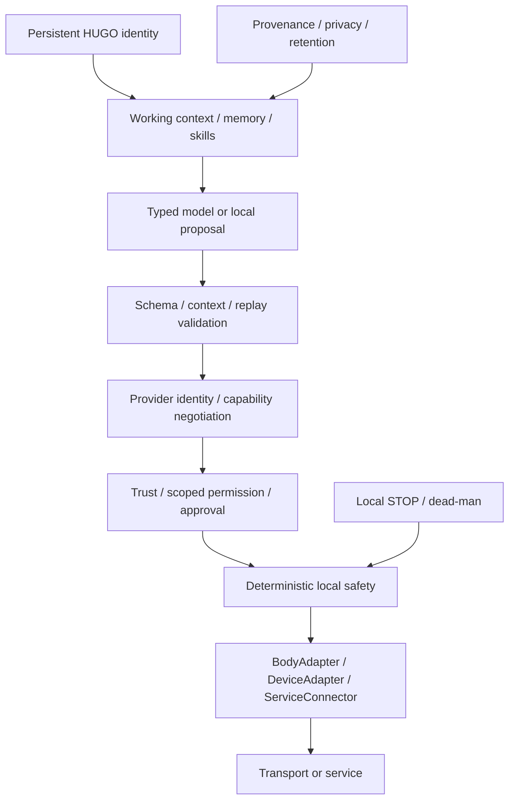

# Architecture: identity, proposals and authority

Models never receive a raw GATT or transport handle. Discovery is an observation;
manifests are claims. Neither supplies permission or establishes an active body.
Transport generation, authority-session identity and freshness remain distinct.

## The visible evaluation shell

`HugoShowcaseActivity` is a separate entry point, with a separate application ID
and no network, Bluetooth, camera or microphone permission. The live private
activity and connected-device service are not registered in its manifest.

The light demo uses `ShowcaseSession` → the unchanged `DefaultSafetyController`
→ `SimulatedRobotBody`. Confirmation is a presentation-only gate; it is not a
claim that the entire production H030 orchestration is wired into this shell.
Reconnect uses the existing motion-authority generation reducer. Local stop uses
the existing emergency-stop reducer; AI reset remains rejected.

The memory lab calls the existing `SemanticFactFactory`. Model-inferred output
starts as a candidate; self-validation is rejected. A user correction creates a
governance-preserving successor envelope. The lab never commits a canonical
change-set. Durable encrypted storage has separate tests and adapters.

All original pure-package architecture guards remain. The showcase domain is
added as another guarded boundary; Android UI imports cannot enter it.
